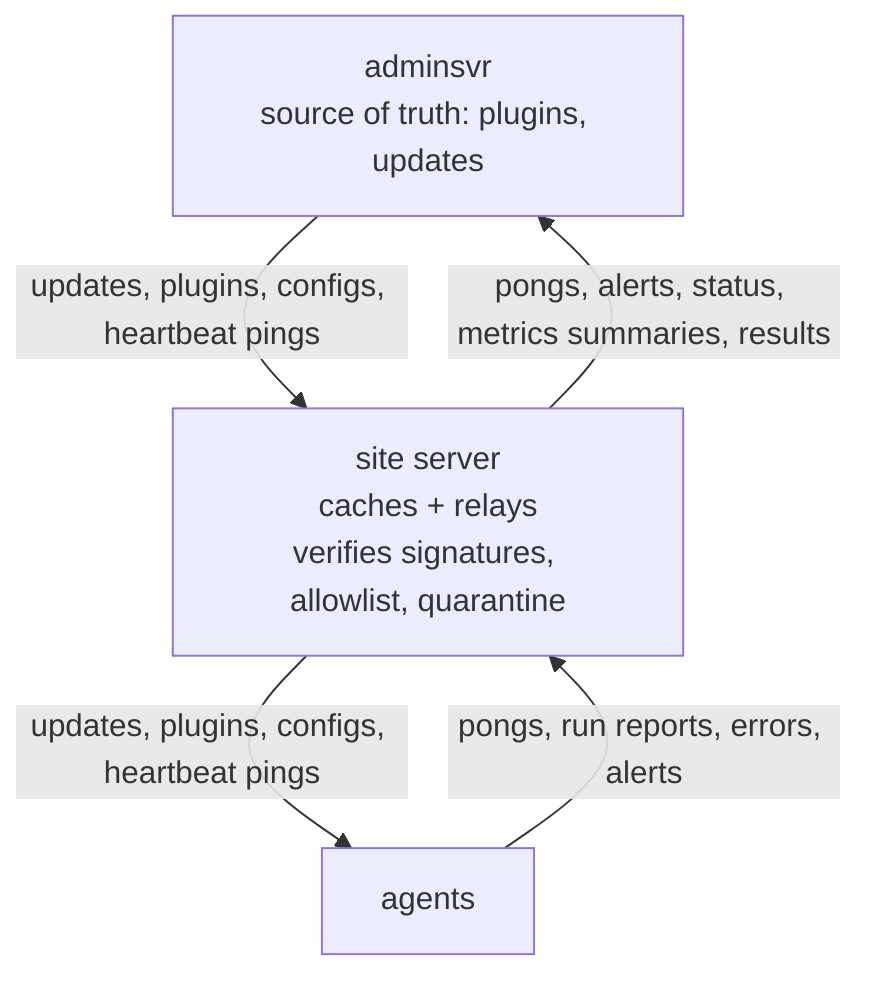

# Admin server (adminsvr) and the SRE app: design proposal

Status: **proposed** (2026-10-31). Nothing is built yet. Extends [SERVER-AGENT.md](SERVER-AGENT.md). Placeholders only
(SERVER01, WS-01, example.local, 198.51.100.x, adminsvr.example.com).

## Decisions (Michael, 2026-10-31)

These are decided and supersede the earlier recommendations and open questions in this doc and in SERVER-AGENT.md.

1. **Host:** adminsvr runs on any host (configurable: listen addresses, public URL, DB URL, data dir). Production runs on
   Michael's VPS. Nothing in the design is tied to one host.
2. **Containers:** test containers use **rootless Podman** on alien-blue. The compose files are Podman-compatible:
   - no Docker-only features, no privileged ports inside the containers (use 8443/8080 and map them)
   - named volumes with `:Z` labels
   - `podman compose` or `podman-compose` both work
   Docker remains possible but is not tested.
3. **Platforms:** Android, **iOS**, web, and Linux/Windows/macOS desktop. Pending: **Mac build/signing step** (Apple
   developer account, signing identities, TestFlight). It happens once Michael's Mac is on.
4. **Paging:** no email, ntfy, webhook or Pushover. Every alert goes through one of:
   - the **adminsvr app**, including its push notifications
   - the **adminsvr CLI** (`itcmdr-admin`). It has **full feature parity with the app, as a hard requirement: every
     app action has a CLI command**, and the release checklist checks this.
   - a future **adminsvr agent**. Placeholder: Michael will describe it later, and nothing depends on it yet.
5. **Alert levels:** all levels (Critical, Cautious, Informational) are delivered in the app. There are no digest or
   office-hours paging rules. Instead, each user has **per-level notification settings** in the app and CLI (push
   on/off, sound, quiet times on the device).
6. **mTLS from the start** on every link (agent → server, server → adminsvr), alongside pinned TLS and signed
   messages. See "Client certificates" below.
7. **Heartbeats:** 60 s interval, non-responsive after 5 missed, office-hours profile available. Every value is
   configurable **per tier and per agent or server**, in the settings registry, the app and the CLI.
8. **Ports:** 50051 at the site; 443 (web/app API) and 8443 (SiteLink) on adminsvr. All configurable.
9. **Releases:** owner-signed, plus a second approver. **Only owners and admins can be the second approver; SREs
   cannot approve.** Rings: VM → one office → all.
10. **No PowerShell agent fallback.** The office server also runs the new Rust agent, so it is watched like every PC.
    The PS agent (task-based runner, poller) is retired at the parity cutover (the v0.20.0 agent switch). The PS check
    plugins stay, hosted by the Rust agent.
11. **Roles (confirmed exactly as follows):**
    - adminsvr roles and site roles stay separate.
    - SREs start with no assigned servers.
    - Every remote command carries dual signatures (the adminsvr root key and the acting user's device key). It is
      checked against the site allowlist and audited on the site with the user's identity.
    - Never-remote items stay never-remote.
    - **Owner:** can do everything, signs releases, manages owners. There is always at least one owner.
    - **Admin:** full access, manages users and assigns servers. Cannot create owners or edit owner accounts.
    - **SRE:** assigned servers only.
12. **Remote upgrades are ON by default** at every site. They roll out automatically through the rings, with
    health-gated auto-pause (a failed health check or new Critical alerts in a ring pause the rollout) and automatic
    rollback. The off switches are the global freeze and the site-local `adminsvr.enabled=false`.
14. **Key-based auth for adminsvr users** (same as the site server) and **every state-changing action and every push
    is signed, rejected if unsigned, and logged** in an append-only, hash-chained audit log. See "User auth" and
    "Signed changes and the audit chain".
13. **Users category:** hidden from SREs except their own account and activity.

### Client certificates (mTLS)

- **CAs:**
  - Each site server has a **site CA** (Ed25519 key in DPAPI, certified by the master key) that issues agent client
    certs.
  - adminsvr has an **adminsvr CA** (offline-capable root, plus an online issuing intermediate) that issues site
    client certs.
- **Issue:**
  - At enrollment the agent (or site) generates its key and sends a CSR with the one-time token. It receives a client
    cert (CN = agent or site id, SAN = machine name, 90-day lifetime) plus the CA cert to pin.
  - Servers require and verify the client cert on every connection, and the cert's id must match the signing key of
    the messages.
- **Rotation:**
  - Automatic renewal over the existing stream at 2/3 of the lifetime (a new key and CSR, signed with the old key).
  - An overlap window keeps the old cert valid until the new one is in use.
  - CA rollover publishes the new CA cert over the stream before it starts issuing.
  - Expiry within 14 days without renewal raises a Cautious alert, and within 3 days a Critical one.
- **Revocation:**
  - Revoking an agent or site in the app or CLI adds its serial to a revocation list held by the issuer and checked on
    every handshake.
  - It also closes the live stream at once and is audited.
  - A revoked machine must re-enroll with a new token.
  - Lost CA key: re-issue the CA (from the master key on the site, or from the offline root on adminsvr) and
    re-enroll.

## 1. Three tiers

```
adminsvr (offsite, container)        <- SRE app (Android, iOS, web, desktop)
   ^  one long-lived gRPC stream per site, dialed by the site
site server (SERVER01, in the office) <- on-site app (desktop)
   ^  one long-lived gRPC stream per agent, dialed by the agent
agents (WS-01 ...)
```

Sites are behind NAT, so **the site server dials adminsvr**. This is the same pattern as agent → server:
`SiteLink.Connect(stream SiteMessage) returns (stream AdminMessage)`.

### Site enrollment and mutual identity

1. An adminsvr owner or admin creates the site in the SRE app and gets a **one-time site enrollment token** (24 h).
   The token holds the adminsvr URL, its TLS certificate fingerprint and a secret (only a hash is stored).
2. On the site server, in person: `itcmdr-cli adminsvr enroll <token>`. The site generates its own Ed25519 **site
   key** (DPAPI LocalMachine, `keys/site.key`) and sends its public key, its master public key fingerprint, version
   and site name.
3. adminsvr stores the site key. In return, the site stores and **pins**:
   - adminsvr's TLS certificate fingerprint
   - adminsvr's **command-signing public keys**: one per adminsvr user device key that may approve commands
     (section 6), delivered and refreshed over the link, each signed by the adminsvr root key that the site
     pinned at enrollment.
4. Both directions carry signed messages:
   - **Site → adminsvr:** every message is signed with the site key and has a monotonic `seq`.
   - **adminsvr → site:** every *command* is signed by the user (or users) who approved it **and** by the adminsvr
     root key. The site verifies both against the pinned keys. TLS alone is never trusted for authorization, so a
     stolen adminsvr TLS key cannot issue commands.
5. A site can **unlink** locally (`itcmdr-cli adminsvr unlink`), and adminsvr can revoke a site. Either side ends the
   link at once.

### What flows each way

| Down (adminsvr → site) | Up (site → adminsvr) |
|---|---|
| Server upgrades (signed release packages) | Alerts (all levels, with state changes: ack/resolve made on site) |
| Agent release packages and plugin packages, forwarded into the site's own validation/quarantine | Heartbeat + site status (version, uptime, auth mode, backup age, cutover state, agent counts by state) |
| Commands from the allowlist (section 6): run schedule now, pause/resume a schedule, set a setting, enable/disable a plugin, start a backup, ack/resolve an alert | Metrics **summaries** (rollups, not raw logs) |
| Config documents (settings, schedules) per site, versioned | Command results (`Applied` ok/failed, output summary) |
| Heartbeat pings | Its own audit and call-log summaries (counts, failures) |

### The push loop (symmetric at each tier)

adminsvr is the **source of truth for service plugins and updates**. Site servers **cache and relay** them, and at each hop they
still verify signatures and the local allowlist. The same four things flow down at both tiers, and heartbeats run both ways:



- **Updates:** server and agent releases. adminsvr publishes; the site applies its own server release and relays agent
  releases to its agents in rings.
- **Plugins:** adminsvr holds the catalog and versions. A plugin pushed down to a site goes through **the same validation
  and quarantine at the site** as a locally installed package (master-certified signer, checksum, manifest checks,
  quarantine on failure) before any agent receives it. Agents verify again.
- **Configs:** settings, schedules and per-agent config, versioned. The site applies them only if allowed by its local
  allowlist, then derives the agent configs.
- **Heartbeats, both tiers:**
  - adminsvr pings site servers and they pong; site servers ping agents and they pong.
  - Each tier has its own interval and missed threshold: `adminsvr.heartbeat_secs` 60 with `site_missed` 5 by default,
    and the agent settings in SERVER-AGENT.md.
  - Both use the late → non-responsive states, and a non-responsive alert is raised at the tier that noticed. A
    non-responsive agent alert also travels up to adminsvr.
  - Each side also watches the other's pings: a site that hears nothing from adminsvr marks the link down and keeps
    running standalone.

### When adminsvr is unreachable

- The site runs **fully standalone**. Nothing in the site depends on adminsvr for its function: backups, agents,
  schedules, plugins, local alerts and the on-site app all keep working.
- **Alerts while adminsvr is down:** there are no site-side notifiers (decision 4). Alerts stay visible locally in the
  on-site app and `itcmdr-cli`, and are queued for adminsvr. adminsvr itself raises a Critical "site unreachable"
  alert to SREs after the missed threshold, so the outage is still paged.
- Upstream messages go to a durable outbound queue (`adminsvr-queue.db`, capped by `adminsvr.queue_max_mib`, oldest
  Informational dropped first, and the drop itself is reported). The site reconnects with backoff (1 s → 5 min,
  jitter).
- adminsvr marks the site **late / unreachable** using the same heartbeat state machine as for agents and pages SREs
  (a "site down" alert is Critical by default).

### Site-server self-upgrade via adminsvr

- **Release package:** `itcmdr-server-release`, signed by the release key. It needs owner approval in adminsvr (and
  two-person approval, section 6).
- **On the site:** the package is verified against the master public key, a release signer that is a pinned
  **owner**, and the command signatures.
- **Rings:** across sites (ring 0 = the test VM site, ring 1 = one office, ring 2 = all). Each ring must report a
  healthy heartbeat and `setup check` OK for `adminsvr.upgrade_soak_mins` before the next starts.
- **Apply:**
  1. Take a fresh **pre-upgrade backup**.
  2. Stage the release, then hand off to `itcmdr-server-watchdog`, a small service upgraded only by the installer.
  3. The watchdog stops the service, swaps `current`/`previous`, starts it and health-checks it (gRPC up,
     `setup check` OK, adminsvr link back) within 5 min.
  4. If the health check fails, it **rolls back** automatically to `previous` and restores the pre-upgrade DB if the
     schema changed.
- Upgrades are **on by default** and roll out automatically through the rings. A failed health check or new Critical
  alerts in a ring pause the rollout automatically, and the failing site rolls back. Off switches: the global
  freeze, or `adminsvr.enabled=false` on the site.

## 2. Data model and RBAC

### Tables (adminsvr)

- `users` (id, email, display name, role, status: active/disabled, created_by, created_at)
- `credentials` (user, kind: password | totp | webauthn, data, created_at, last_used)
- `devices` (user, app device key, platform, push token, approved_at, revoked_at)
- `device_keys` (key id, device, public key, created, rotated_from, revoked_at)
- `audit_chain` (append-only, hash-chained; see "Signed changes and the audit chain")
- `sites` (id, name, site key, status, version, last_seen, ring, tags)
- `site_scopes` (user, site): which sites an SRE can act on (empty = none)
- `commands` (id, site, kind, payload, requested_by, approvals, state: pending/approved/sent/applied/failed/expired, results)
- `alerts` (mirrored from sites: site, level, key, state, timestamps)
- `metrics_rollup` (site, machine, metric, window, value)
- `audit_log` and `call_log` (same shape as the site's, SERVER-AGENT.md section 7)

### Roles

| Capability | owner | admin | sre |
|---|---|---|---|
| Receive alerts, ack / resolve / silence (scoped sites) | ✅ all sites | ✅ all sites | ✅ scoped sites |
| View sites, health, metrics, audit and call logs | ✅ | ✅ | ✅ scoped sites (audit: own and scoped-site entries) |
| Push config / run allowlisted commands to a site | ✅ | ✅ | ✅ scoped sites, risky ones need approval |
| Approve a pending risky command | ✅ | ✅ | ❌ |
| Push plugin packages to sites | ✅ | ✅ (needs a second approver) | ❌ request only |
| Push server or agent **upgrades** (code) | ✅ (needs a second owner/admin approver) | request only | ❌ request only |
| Create / disable users; set role sre or admin | ✅ | ✅ (not on owners) | ❌ |
| Grant **owner** | ✅ | ❌ | ❌ |
| Edit, disable or remove an owner | ✅ | ❌ | ❌ |
| Scope SREs to sites | ✅ | ✅ | ❌ |
| Enroll / revoke sites | ✅ | ✅ | ❌ |
| Adminsvr settings, notifier channels, kill switch | ✅ | settings and channels only, not the kill switch | ❌ |

Rules and edge cases (enforced on the server; the app only mirrors them):
- New users default to **sre**, with no site scopes until an owner or admin grants them.
- **Admins can't grant owner**, can't change an owner's role, and can't disable or remove an owner. "Promote to
  admin" is allowed. An admin demoting another admin is allowed. An admin promoting themselves is refused.
- **The last owner** can't be demoted, disabled or removed, by anyone including themselves. Two owners are
  recommended.
- **Self-demotion** is allowed (owner → admin, admin → sre) unless it would remove the last owner. It needs
  re-authentication and is audited.
- Every role change, user change, scope change and approval is audited, with the call log id.
- Bootstrap: `adminsvr init` creates the first owner from the console (an enrollment code for the first owner's device key, plus the offline recovery words
  shown once). There is no default password.

### Relation to the site roles

Site roles today are `owner`, `admin`, `user`, `client` (+ the proposed `agent`). **Recommendation: keep them
separate; adminsvr roles do not map down.**
- A site sees adminsvr as **one principal**, the link. The link holds a site-local role (`adminsvr`), capped by the
  site's allowlist (section 6).
- The real user behind each command is recorded in the site's audit log (from the command signature), so the site
  can answer "who did this", but it does not grant that user any site role.
- Keeping them separate means a compromised adminsvr account can never act as a site owner. Site owner actions
  (keys, restore with the words, auth mode) stay local, in person.

### User auth (decided: key-based, same as the site server)

All adminsvr users use **the same key-based signed-request auth as site server users** (`docs/SIGNING.md`), for
security and consistency. There are no passwords, TOTP, passkeys, session cookies or refresh tokens.
- **Same code:** the adminsvr reuses the site's request-signing code and libraries: the Rust verifier and canonical
  form from `server/src/auth.rs`, the Dart `itcmdr_signing` and `itcmdr_keystore` packages, and the shared test
  vectors. The two signers cannot drift apart.
- **Per-device keypair:** Ed25519, generated on the device, never exported. Where it is stored:
  - Windows: DPAPI
  - macOS and iOS: Keychain (Secure Enclave-backed where available)
  - Linux: secret-tool / libsecret
  - Android: Keystore
  - Web: a non-extractable WebCrypto key in IndexedDB (weakest, see the open questions)
  - The `itcmdr-admin` CLI uses the same stores as desktop.
- **Every request is signed** (method, payload hash, timestamp, nonce, key id). adminsvr `auth_mode` is
  **signed-only**, with no unsigned or legacy mode. Each request authenticates itself, so no session state is needed.
  The pinned TLS + mTLS on the SiteLink stays as it is.
- **Enrolling a new user:**
  1. An owner or admin creates the user (signed, audited). The role is **sre** by default with no assigned servers;
     only an owner can pick owner.
  2. That produces a one-time enrollment code (24 h, single use).
  3. The new user's app or CLI generates a device key and submits its public key with the code.
  4. adminsvr shows a fingerprint, and the creator confirms it out of band (a signed approval). The key is then
     active.
- **Adding a device:** sign in from an existing device to issue a device code, or ask an owner or admin for one. The
  approval is signed by an existing device of the same user or by an owner or admin. Each device has its own key id.
- **Rotation:** in Settings or `itcmdr-admin device rotate`. A new key is generated and the request is signed by both
  the old and the new key. The old key is retired, and keys older than `auth.key_max_age_days` (default 365) raise
  a Cautious alert.
- **Revocation:** revoking a device or user (signed, audited) rejects its key id at once and closes its live streams.
  Pending approvals signed by that key are voided.
- **Lost device:** use another enrolled device to revoke it. Otherwise an owner or admin revokes it and issues a new
  enrollment code. A lost key for the **last owner** is recovered at the adminsvr console with `adminsvr recover-owner`,
  which needs host access and the adminsvr's offline recovery key (the same idea as the site's 24 words).
- **Bootstrap:** `adminsvr init` (console) creates the first owner's enrollment code and the offline recovery key
  words, shown once.

### Signed changes and the audit chain (decided)

**Every state-changing action on adminsvr is a signed request, and unsigned changes are rejected.** That includes:
- user and device enrollment, role changes, server/site assignment
- settings
- plugin and release uploads, release approvals
- freezes and the kill switch
- alert ack / resolve / silence
- CA and key operations (issue, rotate, revoke)
- site enrollment and revocation
- every push to sites: updates, plugins, configs and commands. Heartbeat pings are signed by the adminsvr root key
  but are **not** chain entries, because they would only add noise; heartbeat state changes are entries.

Each action is one entry in an **append-only, hash-chained audit log** (`audit_chain`). Each entry holds:
- seq, time
- action, target (user / device / site / agent / object id)
- signer user id, key id, the request signature, the payload hash
- **before and after** (or a JSON diff, with secrets redacted to hashes)
- result (ok / refused + reason / failed), and the push results reported back by sites
- `prev_hash`, plus `entry_hash = H(prev_hash || canonical entry)`

How the chain stays tamper-evident:
- The DB role used by adminsvr can only `INSERT`, never update or delete this table.
- Every hour (`audit.checkpoint_mins`) a checkpoint (seq + head hash) is signed with the adminsvr root key, and the
  site receives it over the SiteLink. Each site keeps the checkpoints, so a rewritten adminsvr chain no longer
  matches what the sites hold.
- `itcmdr-admin audit verify` re-walks the chain and checks every signature and checkpoint. It runs daily and raises
  a Critical alert on a mismatch.

Sites verify every push signature (the user's key + the adminsvr root key) before applying it. **The site's own
audit log keeps its existing role:** it records what the site accepted or refused and why, with the adminsvr entry
seq for cross-reference.

**Audit view (app and CLI, parity):** Users → Audit. Filter by signer, key, action, target, site and result. Each
entry shows the before/after diff, its signature and chain status ("verified up to seq N"), with CSV/JSON export.
CLI: `itcmdr-admin audit list|show|verify|export`. SREs see only their own entries and their assigned sites.

## 3. The SRE app (built with the adminsvr, Flutter)

### Platforms and build targets

One Flutter codebase, `adminapp/`:
- **Android** (Play internal testing first, then APK sideload for the office)
- **iOS** (TestFlight)
- **Web** (served by adminsvr itself at `/app`, no third-party hosting)
- **Desktop:** Windows (MSIX or Inno, like the on-site app), macOS and Linux (AppImage), as needed

CI builds Android, web and Linux on Linux, and Windows on the test VM. iOS/macOS need a Mac and an Apple developer
account (open question).

### Shared packages with the on-site app

Turn `app/` into a small mono-repo of Dart packages:
- `packages/itcmdr_proto`: generated protos (site + adminsvr)
- `packages/itcmdr_signing`: canonical request signing, sealed words, test vectors (`proto/*_vectors.json`)
- `packages/itcmdr_keystore`: key storage, DPAPI/keyring/Keychain/Keystore/Secure Enclave/WebCrypto
- `packages/itcmdr_ui`: shared widgets (alert list, metric charts, settings registry editor, confirmation dialogs,
  log viewer)

The on-site app (`app/`) and the SRE app (`adminapp/`) stay **separate apps**: different users, servers, threat
models and store listings. They share the packages, not the shell.

### Navigation: four categories

The app has exactly four top-level categories (bottom bar on mobile, side rail on web and desktop). **Device enrollment/unlock and
Settings are chrome** (the account menu), not categories. The **global alert inbox** is reached from Servers or from a badge
in the app bar or a notification tap. It is not a fifth category.

1. **Users**
   - Users: invite, role, site scopes, disable.
   - Devices and keys: approve, rotate, revoke.
   - The **audit and call log**. It lives here because it answers "who did what", and is filterable by site, which
     links into Servers.
   - Admins are never offered owner; owner rows are read-only for admins; the last owner can't be demoted.
   - **SREs: hidden, except "My account / my activity"** (recommended), so they see their own audit entries but no
     other users.
2. **Service Plugins**
   - Catalog, versions and changelogs.
   - Per-site deployment status: which version is enabled where, and per-agent results.
   - Rollout with preview and approval (two-person for pushes), and enable/disable per site.
   - **Quarantine view:** packages that sites rejected during validation, with the reason.
   - SREs can view everything, and request a push or rollout.
3. **Servers**: see every server, drill into one, and manage its plugins, updates, configs and metrics.
   - **Overview (all servers at a glance):** one row or card per site server, showing:
     - status (online / late / non-responsive) and last heartbeat
     - version
     - open alerts by level (Critical / Cautious / Informational)
     - agent counts (healthy / late / down)
     - pending updates and plugin rollouts
     - freeze or kill-switch state (global freeze, or the site has disabled the link)
     - Sortable and filterable by status, alert level, version, ring and tag. Scoped to the user's assigned sites
       (owners and admins see all). The global alert inbox is linked from here.
   - **Server detail page** (tabs on desktop and web, sections on mobile):
     - **Overview:** health, backup age, link state, open alerts (ack, resolve, silence), and the agents list with
       heartbeat state. Drill down to an agent to see its last runs, errors, version, alerts and metrics.
     - **Plugins:** what's installed and which version, per agent where it differs. Enable or disable, push a catalog
       version to this server, and see this server's quarantine (rejected packages with the reason). Pushes still go
       through site validation and quarantine.
     - **Updates:** this server's and its agents' versions. Stage or approve an update for this server only, outside
       its ring if needed (owner approval is still required). History and rollback.
     - **Configs:** settings and schedules, viewed and edited with a diff preview from a site dry-run.
       - Gated by the site's allowlist: items outside it are greyed out with a reason.
       - The never-remote items (auth mode, keys, restore, words, cutover, the allowlist itself) are shown
         **read-only**.
     - **Metrics:** charts for the server and each agent (disk, uptime, run durations and failures, alert counts),
       with time range and comparison.
   - **Relation to the other categories:** Service Plugins and Updates are **fleet-wide** (catalog, releases, rings,
     rollouts across sites). The server page is the **per-server view and actions** on the same objects. It uses the
     same approval rules (two-person for plugin pushes and upgrades, owner for upgrades), the same RBAC (SREs act only
     on assigned servers, and only request code pushes) and the same audit and call log entries. A rollout started on
     either side shows up in both.
4. **Updates**
   - Server and agent releases.
   - Rings (test VM → one office → all) with soak status.
   - Pending approvals (two-person; an owner for upgrades).
   - Per-site rollout progress, and rollback and history.
   - The global freeze (kill switch) banner is shown here and in Settings; only owners can toggle it.
   - SREs view and request only.

### Push notifications

- Android uses FCM and iOS uses APNs, with keys held by adminsvr (decision 4; no ntfy).
- Web and desktop use the app's live stream while it is open, plus the OS notification when it runs in the
  background (desktop) or Web Push (web).
- Payloads carry only an alert id, level and a short template title, never PHI. The app fetches details over the
  signed API.
- Per-level notification settings are per user and per device.

### CLI parity (`itcmdr-admin`)

Every app action has a CLI command: users, devices, servers, alerts, configs, plugins, updates, approvals, audit,
settings and the freeze. Both call the same gRPC API with device-key signing. A parity test lists the app's actions
and the CLI commands and fails if one is missing.

### adminsvr agent (placeholder)

Michael will describe this later. It is reserved as a third alert and control surface. Nothing depends on it yet.

## 4. Hosting adminsvr offsite

- **Deployment:** one container image (`itcmdr-adminsvr`, Rust, static binary, distroless), with Compose for
  adminsvr + Postgres + a reverse proxy (Caddy, automatic TLS for the web app), Podman-compatible (rootless) compose. Host, URLs, ports and DB URL are configurable. The SiteLink gRPC port uses
  adminsvr's own pinned certificate, separate from the web TLS.
- **DB:** **Postgres** (recommended). It handles concurrent users and many sites, row-level scoping, proper
  backups/PITR, and managed options. SQLite/SQLCipher stays the right choice for site servers (one box, no admin).
  Secrets at rest: application-level encryption of credentials and keys, plus disk encryption on the host.
- **Backups:** nightly `pg_dump`, encrypted (age) with an offline key, copied offsite, plus WAL archiving for PITR.
  A monthly restore test, documented.
- **HA expectations:** single instance is fine to start. Sites are standalone and queue, so an adminsvr outage only
  delays visibility and paging through adminsvr. Target: restore within 4 h, an RPO of 24 h (or 15 min with WAL).
  A health check from outside (an external uptime check) pages if adminsvr itself is down.
- **Multi-site / tenancy:** one adminsvr serves many sites of **one organization** (single tenant). Multi-tenant
  (several unrelated practices) later, as separate deployments, not shared tables. Simpler and safer for HIPAA.

## 5. Security

adminsvr can push code to every office PC, so it is the highest-value target. Controls:

- **Least privilege + scoping:** SREs act only on scoped sites. Code-changing actions are never SRE-only.
- **Two-person approval** (recommended): server/agent upgrades and plugin pushes need a requester and a *different*
  owner or admin approver. Upgrades need at least one owner. Both signatures travel with the command and the site
  verifies them. Optional per site: `adminsvr.require_two_person = true` (default true).
- **Site-side allowlist** (`adminsvr.allowed_commands`, edited only locally on the site, by a site owner):
  - Default: alert ack/resolve, run schedule now, pause/resume schedule, set non-security settings, enable/disable
    plugins, start backup.
  - Upgrades (on by default, decision 12).
  - **Never allowed remotely, whatever the allowlist says:** auth mode, key registration/revocation, restore, word
    entry, cutover switch, unlinking safeguards, and the allowlist itself.
- **Kill switches:**
  - adminsvr owners can freeze all pushes globally (a "freeze" banner, commands refused).
  - Each site can set `adminsvr.enabled = false` locally (link closed, nothing accepted). That is one CLI command,
    and the same works from the on-site app for a site owner.
- **No PHI leaves the site.** It's a office, so think HIPAA: only **operational metadata** goes up.
  - Allowed up: machine names (placeholders like WS-01 in docs), check ids and statuses, service names, versions,
    metric values (disk, uptime, counts), alert titles built from templates, error messages and backtraces
    **after** redaction, backup sizes/ages, and call/audit counts.
  - Never up: patient names or ids, file names or paths under clinical data folders (e.g. imaging shares), file
    contents, screenshots, practice-software database contents, free-text log lines from clinical apps, user
    documents.
  - Enforced by an **egress filter** on the site: only typed fields from an allowlisted schema go up. Free text
    passes a redactor that drops paths under configured clinical roots and anything matching patient-id patterns. The
    filter's own decisions are logged locally.
  - Plugins declare `phi_safe = true` for fields they promise are clean. The default is not safe, so the field is
    dropped.
- **Code signing chain:** release and plugin packages keep the existing site signature rules (master-certified
  signer). adminsvr can't sign packages on its own, it only forwards them. A compromised adminsvr can therefore at
  most replay already-valid, site-trusted packages, and the allowlist plus two-person approval cover that.
- **Audit everything** on both sides. Each site keeps its own copy of every command it received, with signatures.

## 6. Roadmap (merged with SERVER-AGENT.md)

The site-side contracts come first, then the agent, then the adminsvr MVP, with the SRE app built **in the same
releases** as the adminsvr features it uses.

| Version | Scope | VM / test plan |
|---|---|---|
| v0.15.0 | Error contract (`itcmdr-common` + derive), call log | as in SERVER-AGENT.md |
| v0.16.0 | Site alerts in the on-site app and CLI (no external notifiers); the alert record is also the shape that goes up to adminsvr | as in SERVER-AGENT.md |
| v0.17.0 | Rust agent (also on the office server), enrollment with mTLS client certs, heartbeats (configurable per tier/machine), offline queue | as in SERVER-AGENT.md |
| v0.18.0 | Agent runs plugins + schedules, report-only parity | as in SERVER-AGENT.md |
| v0.19.0 | **adminsvr MVP + SRE app v1:** adminsvr container (Postgres, rootless Podman for tests), `itcmdr-admin` CLI with app parity, mTLS site certs, FCM/APNs push, `adminsvr init`, users/roles/RBAC rules, key-based signed-request auth (reused site signing code), device enrollment, rotation, revocation, `recover-owner`; hash-chained audit log of every signed change and push, checkpoints to sites, `audit verify`; SiteLink (site enrollment, pinned TLS, signed messages, up: heartbeats/status/alerts, outbound queue). SRE app: chrome (sign-in/2FA, settings) + Users (incl. audit/call log) + Servers (list, health, agents, alerts, alert inbox); web + Android + iOS (pending Mac signing) + Linux desktop builds. Dart packages split out of `app/` | adminsvr in a container on alien-blue; the VM site links to it; alerts raised on the VM reach the app; kill the container and check the site queues and adminsvr reports it as unreachable on restart; RBAC tests incl. the owner rules; an unsigned or wrongly signed change is rejected; a revoked key is refused at once; tampering with an `audit_chain` row is caught by `audit verify` and by the site checkpoints; app/CLI audit parity test |
| v0.20.0 | Config over the agent stream + gated agent switch (PS agent retired here); **adminsvr down-commands:** allowlist, preview/dry-run, two-person approval, freeze/kill switch; metrics summaries up. SRE app: Servers configs/commands + metrics explorer, and **Service Plugins** (catalog, rollout, quarantine view); adminsvr becomes the plugin source of truth, sites cache and relay | push a setting and a schedule from the app to the VM site; refused when off the allowlist; two-person flow; egress filter tests (PHI patterns dropped) |
| v0.21.0 | Agent self-upgrade (release plugin, rings, watchdog) + **site-server self-upgrade via adminsvr** (pre-upgrade backup, server watchdog, rollback). SRE app: **Updates** (releases, rings, approvals, rollback) | broken release rolls back (agent and server); ring gating across two sites (VM + a second test site container) |
| v0.22.0 | Retire share flows; Windows/macOS desktop builds of the SRE app; adminsvr backup/restore runbook + monthly restore test | fresh install with no share dependency; adminsvr restore drill |

## 7. Open questions

All earlier questions are decided (see "Decisions" at the top). Still pending:
- Web app keys: a WebCrypto key in the browser is weaker than an OS keystore. Recommended: the web app is
  read-only plus alert ack/resolve/silence, and approvals, releases, users and CA operations need a desktop or
  mobile device key.
- Offline recovery for adminsvr: recommended 24 words like the site, held by owners only.
- The Mac build/signing step for iOS and macOS.
- The design of the adminsvr agent (Michael, later).
- Podman install on alien-blue (needs sudo, see HANDOVER).
